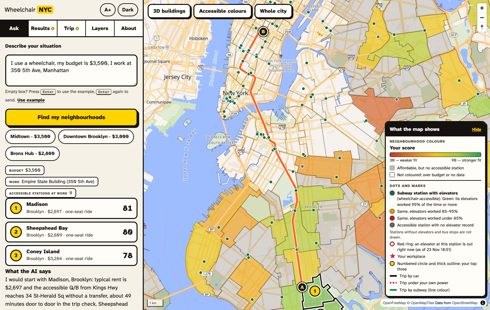
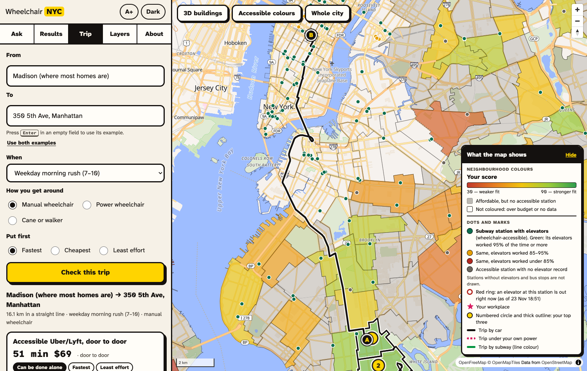
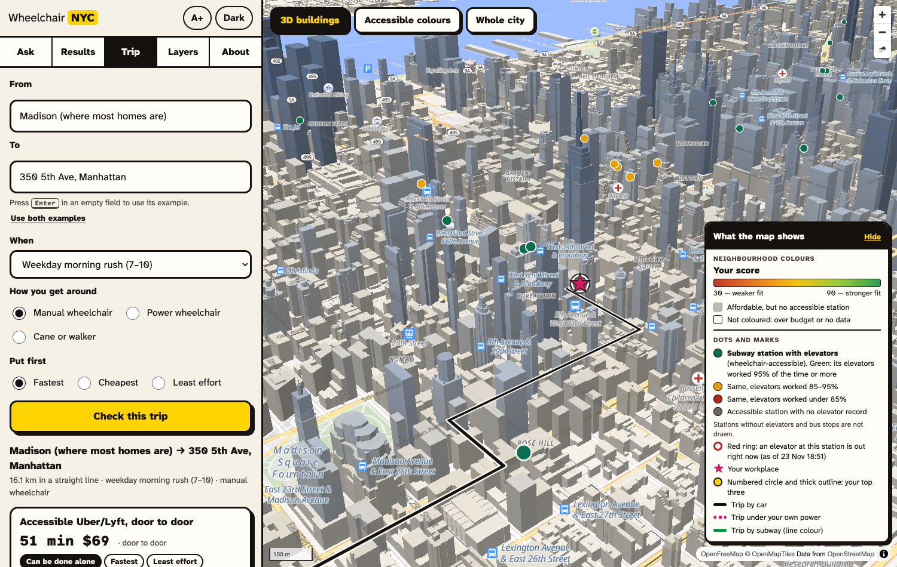

# Wheelchair NYC

**Same rent. Different city.** An apartment listing shows the price. It does not show whether a wheelchair user can
get out of the neighbourhood. This app does.

Built in one evening at the Fable 5.2 Build Day (topic: accessibility, lane: *Smart — "an accessibility tool that
wasn't possible before"*).



## What it does

You type one sentence — *"I use a wheelchair, my budget is $3,500, I work at 350 5th Ave"* — and get:

- **The three New York neighbourhoods you could realistically live in**, each with its typical rent, nearest
  accessible subway station, how often that station's elevators actually worked, whether there is a one-seat
  accessible ride to work, what the back-up ride costs, three pluses and the single biggest risk.
- **A map you can play with**: drag the budget, switch what the colours mean (broken elevators at home, bus stops,
  hills, housing lotteries…), tilt into 3D, toggle a colour-blind-safe palette with patterns and numbers.
- **A trip check from A to B**: by wheels, accessible subway, accessible Uber/Lyft, or a mix — with minutes, cost,
  effort, and whether it can be done alone. Elevators that are out right now are flagged on the route.
- **"Accessibility deserts"**: neighbourhoods that look affordable but have no accessible station and slow
  accessible rides.
- **Heads-ups**: an elevator out today, planned outages, a station due to become accessible, an open
  affordable-housing lottery with units set aside for mobility disabilities.

| Trip check, routes on real streets and tracks | 3D buildings |
|---|---|
|  |  |

## What the model does

The answer is written by Claude working as an analyst with five tools. The default model is `claude-haiku-5-5`
(fast and cheap enough for a public demo); set `WNYC_MODEL=claude-fable-5-2` for the model the app was built with,
which runs more of its own checks:

1. `geocode` — finds the workplace.
2. `score_zones` — ranks all 263 taxi zones with a documented, deterministic 0–100 score.
3. `run_sql` — writes its **own** read-only SQL to verify the facts it is about to state.
4. `plan_trip` — checks the commute door to door.
5. `render_map` — draws the result as a PNG and **looks at the image** to check it agrees with its top three.

Every tool call is shown in the app ("What it did", and the About tab). In testing the model caught a real flaw in
our scoring this way: a neighbourhood was being scored on a station 1.5 km from where people live.

Without an API key the app still works: it answers with fixed rules over the same data and says so.

## Run it

```bash
export ANTHROPIC_API_KEY=...      # optional; enables the model
./run.sh                           # http://127.0.0.1:8765
```

Needs Python 3.11+ and about 1 GB of disk. The first run downloads the public datasets (~0.7 GB, mostly one month
of TLC trips), saves the NYC street map for offline use, and builds a local DuckDB file. No data is stored in this
repository.

Pages: `/` landing · `/map` the app.

To put it on your own server (Docker Compose with HTTPS, or systemd), see [DEPLOY.md](DEPLOY.md).

## Data

All open data, joined to NYC taxi zones. Row counts and join match rates are printed at build time and shown in the
app under About → Data checks.

| What | Source |
|---|---|
| Wheelchair-accessible ride-hail waits, fares and trip times by time of day | NYC TLC High-Volume FHV trips, Sept 2026 (21M trips) |
| Accessible stations, elevator availability, live elevator outages, timetable, track geometry, upcoming accessibility projects, bus stops | MTA / data.ny.gov |
| Building age and elevator buildings | NYC PLUTO |
| Typical rent | Zillow ZORI by ZIP |
| Curb ramps, pedestrian injuries, public restrooms | NYC Open Data (DOT, NYPD, Parks) |
| Broken-elevator complaints, affordable-housing lotteries | NYC HPD |
| Mobility-disability prevalence | CDC PLACES |
| Hospitals and clinics | NYS Department of Health |
| Hilliness | Open-Meteo elevation |
| Street map, routing for drawing, address lookup | OpenStreetMap via OpenFreeMap, routing.openstreetmap.de, Nominatim |

## Honest limits

- **Proxies, not guarantees.** Rent is Zillow's typical market rent, not an accessible apartment's. "Post-1991
  building" and "elevator building" are proxies for accessible housing, not a list of accessible units.
- **Ride-hail data has completed trips only**, so the share of accessible requests that never found a car is
  unknowable and never claimed.
- **Trip check assumptions**: wheeling speed, a 1.3 detour factor, 3 minutes per elevator, and the "alone / help"
  thresholds are rules of thumb. Buses, platform gaps and street slope are not modelled.
- **Elevator outages are a snapshot** taken when the data is fetched. Forecast dates for new accessible stations
  are the MTA's and have slipped before; the station list is typed from project descriptions.
- **Reported crime** is an opt-in layer only and never part of the score: it measures reporting and policing as
  much as safety.
- **Accessibility of the app itself** was designed in (keyboard use, list alongside the map, live announcements,
  no colour-only meaning in accessible mode) but has not been tested with a real screen reader.
- No automated tests. New York City only: the per-elevator history and accessible ride-hail flags that make this
  work do not exist as open data elsewhere.

## Layout

```
app/build_data.py, build_extra.py   data layer → data/prepared.duckdb (with printed checks)
app/engine.py                       scoring, geocoding, read-only SQL, PNG map
app/router.py                       A → B trip check (accessible-station subway graph + ride-hail)
app/agent.py                        the Claude tool loop, with a rule-based fallback
app/server.py                       FastAPI: pages, API, offline street-map tiles
app/static/                         landing page and map app (no framework)
scripts/                            dataset and basemap downloads
research/, MAIN_PROMPT.md           the original brief and research notes for the build
PROGRESS.md                         status, decisions and where the data disagreed with the notes
```

Typeface: Atkinson Hyperlegible (Braille Institute, SIL OFL). Map rendering: MapLibre GL JS (BSD-3-Clause).
